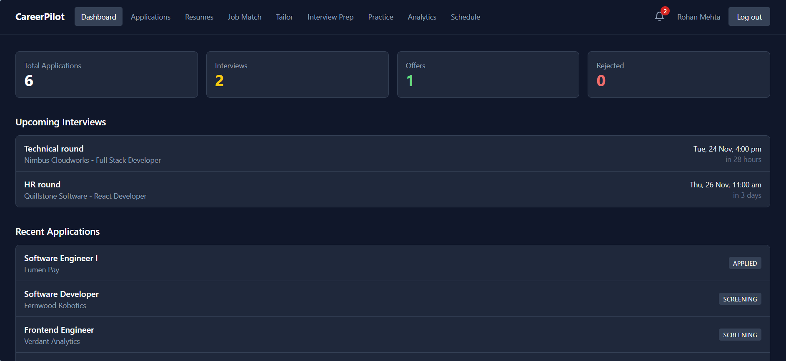
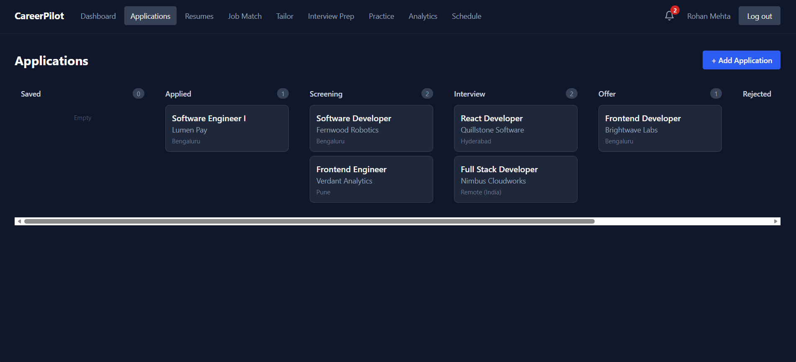
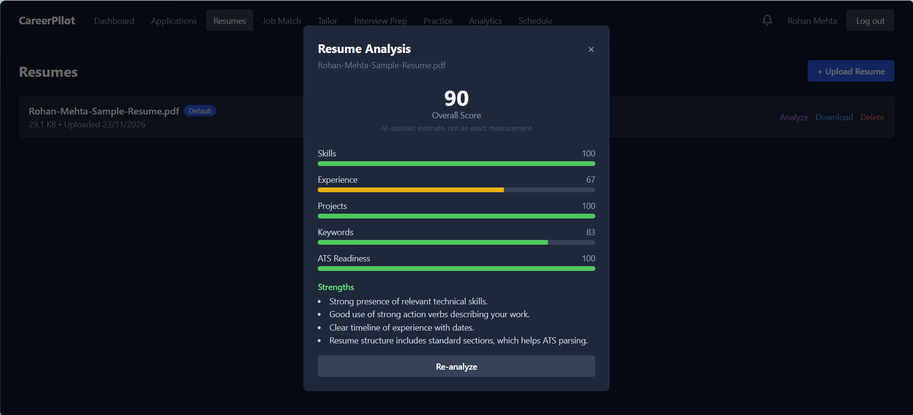
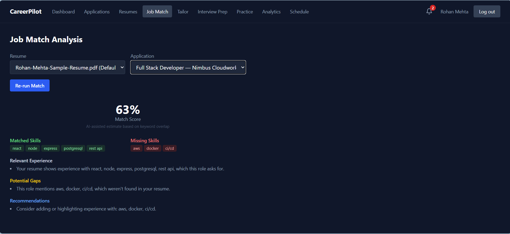
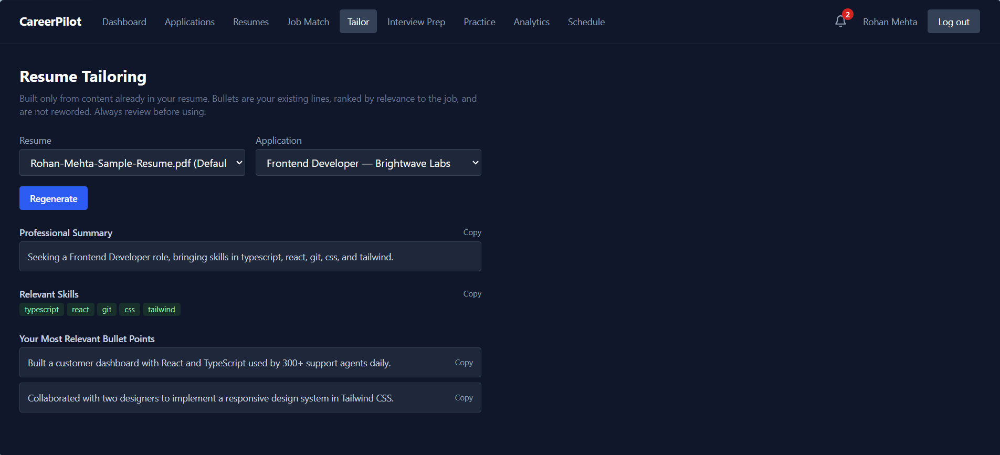
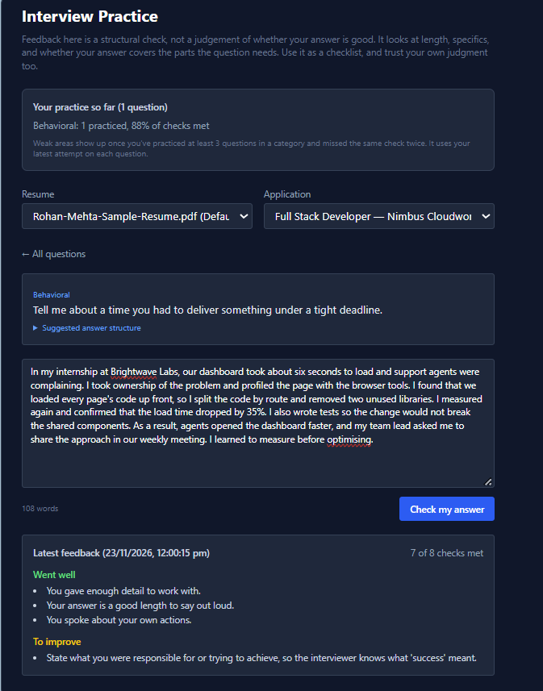
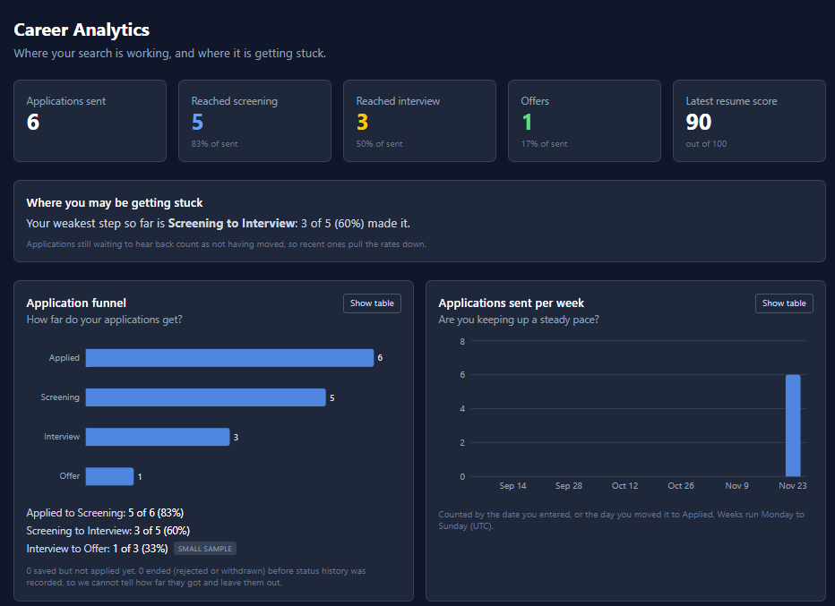
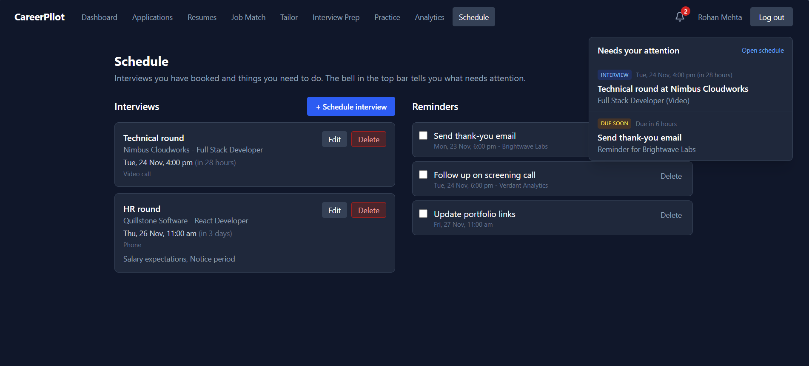
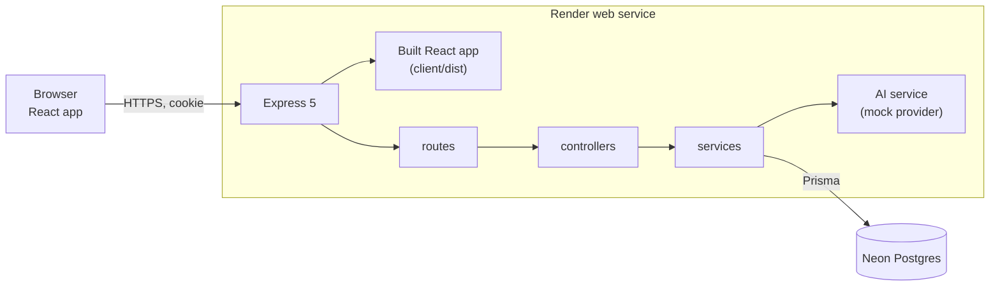

# CareerPilot

A job-search workspace: track applications on a Kanban board, analyse a resume, match it against a job description, tailor it, practise interview questions, and see how the search is going.

**Live demo:** https://career-pilot-3ies.onrender.com
The demo runs on free hosting that sleeps when idle, so the first load after a quiet period can take up to a minute. Registration is open; use any email and a fake password.



## What it does

| Area | What you can do |
|---|---|
| **Applications** | Add, edit and delete applications; drag them across SAVED, APPLIED, SCREENING, INTERVIEW, OFFER, REJECTED and WITHDRAWN. |
| **Resumes** | Upload PDFs (5 MB max, content-checked), set a default, download, delete. Text is extracted so the AI features can read it. |
| **Resume analysis** | Scores for skills, experience, projects, keywords and ATS-friendliness, with strengths and improvements. |
| **Job match** | Compares a resume with an application's job description: matched and missing skills, gaps, recommendations. |
| **Tailoring** | Suggests a summary, skills and bullets for one job, using only what the resume already contains. |
| **Interview prep** | Generates HR, technical, behavioural, project and role-specific questions from the resume and the job. |
| **Practice** | Gives structured feedback on a written answer (length, specifics, STAR structure, and so on) and tracks weak areas. |
| **Analytics** | Funnel by furthest stage reached, response and offer rates, activity over time. |
| **Schedule** | Interviews and reminders, plus in-app notifications (upcoming interviews, overdue reminders, follow-ups with snooze). |

| | |
|---|---|
|  |  |
|  |  |
|  |  |
|  | |

### About the "AI"

The AI features run behind a provider interface (`AIService` → `AIProvider`). The only provider implemented is a **deterministic, rule-based mock**: keyword and structure checks, no external LLM, no API keys, no network calls. Its output goes through the same validation a real model's output would need (scores in range, no skills invented beyond the resume). Swapping in a real model means writing one new provider class. The practice feedback is a structural checklist, not a grade of whether an answer is correct.

## Tech stack

- **Client:** React 19, TypeScript, Vite 8, Tailwind CSS 4, React Router 7, Recharts. Pages are code-split.
- **Server:** Node 22, Express 5, TypeScript.
- **Database:** PostgreSQL with Prisma 7 (`@prisma/adapter-pg`).
- **Auth:** bcrypt password hashes, JWT (HS256) in an HTTP-only cookie.
- **Tests:** Vitest, supertest, Testing Library.
- **Hosting:** Render (one web service) and Neon (Postgres), both on free tiers.

## Architecture



The server is layered: **routes** declare endpoints and middleware, **controllers** translate HTTP to function calls and back, **services** hold the logic and talk to the database through Prisma. Every response uses one envelope: `{ "success": true, "data": … }` or `{ "success": false, "message": … }`.

In production a single Express process serves both the API and the built React app. That keeps the login cookie first-party (no CORS, no cross-site cookie settings) and means there is one thing to deploy.

```
careerpilot/
├── client/                 React app
│   ├── src/pages/          one file per screen (lazy-loaded)
│   ├── src/components/
│   ├── src/services/       API calls
│   └── tests/
├── server/
│   ├── prisma/             schema.prisma and migrations
│   ├── src/
│   │   ├── config/         env validation, database, cookies
│   │   ├── routes/ controllers/ services/ middleware/ validators/
│   │   └── services/ai/    provider interface, mock provider, validators
│   └── tests/              unit/ and api/ (against a real test database)
└── docs/screenshots/
```

## Design decisions worth knowing about

- **Fail-fast configuration.** `parseEnv` checks every environment variable at startup and refuses to boot with a clear message (for example a short `JWT_SECRET` in production).
- **Security basics, tested.** helmet headers, CORS limited to `CLIENT_URL`, an Origin-header check on state-changing requests, rate limits (global, login per account and per IP, register, AI, upload), uniform login timing, normalised emails, PDF files checked by content and not only by type, `Cache-Control: no-store` on the API.
- **Funnel from history.** Every status change is stored as an event, so analytics reflect the furthest stage an application reached, not just its current column.
- **Notifications computed on read.** Pure rules turn interviews, reminders and application state into notifications when requested, so there is no scheduler or stored notification to go stale. Times are stored in UTC.
- **AI output is validated.** A grounding check in the service layer drops skills and numbers that are not in the resume; the provider does not police itself.
- **Resumes live in Postgres.** Free hosting wipes the server's disk on restart, so the PDF bytes are stored in the database (the disk copy is only a fallback for older rows).

## Run it locally

You need Node 22 and a local PostgreSQL.

```bash
git clone https://github.com/ujwal-abhi/Career-Pilot.git
cd Career-Pilot

# server
cd server
npm install
cp .env.example .env        # then fill in DATABASE_URL and JWT_SECRET
npx prisma migrate dev
npx prisma generate
npm run dev                 # http://localhost:5000

# client, in a second terminal
cd client
npm install
npm run dev                 # http://localhost:5173
```

Generate a login-signing secret with:

```bash
node -e "console.log(require('crypto').randomBytes(48).toString('hex'))"
```

`client/.env` should contain `VITE_API_URL=http://localhost:5000`.

## Tests

```bash
cd server
npm test                    # 461 tests: unit + API tests against a separate careerpilot_test database
npm run test:coverage

cd client
npm test                    # 72 tests: utilities, the notification bell, the slow-server notice
```

The API tests run the real Express app against a real PostgreSQL database named `…_test` (created automatically; the test setup refuses to touch any other database). Client tests cover utilities and two components; most pages have no automated tests yet.

## Deployment

One Render web service plus a Neon database.

| Setting | Value |
|---|---|
| Build command | `cd client && npm install --include=dev && npm run build && cd ../server && npm install --include=dev && npm run build && npx prisma migrate deploy` |
| Start command | `cd server && npm start` |
| Health check | `/api/health` |
| Environment | `NODE_ENV`, `NODE_VERSION`, `DATABASE_URL`, `JWT_SECRET`, `CLIENT_URL`, `TRUST_PROXY`, `COOKIE_SAME_SITE`, `SERVE_CLIENT` (see `server/.env.example`) |

Pushing to `main` redeploys; migrations run as part of the build.

## Known limitations

- The AI is a rule-based mock (see above), not a language model.
- Rate limits are kept in memory, so they reset on restart and would not be shared across several server instances.
- Logging out clears the cookie but does not revoke the token (tokens are stateless and expire).
- Notifications are in-app only; there are no emails or push notifications.
- Free hosting sleeps when idle, so the first request after a quiet period is slow.